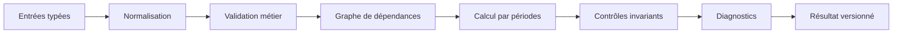

# Moteur financier

**Statut :** Draft  
**Version :** 0.1

## Responsabilité

Transformer un jeu d’entrées validé, un scénario et un Country Pack en résultats financiers déterministes. Le moteur ne gère ni interface, ni autorisation, ni texte IA.

## Pipeline



## Contrat d’entrée

- projet, scénario et version;
- calendrier;
- devise fonctionnelle;
- hypothèses de revenus;
- coûts variables et fixes;
- personnel;
- investissements;
- financements;
- délais et BFR;
- trésorerie initiale;
- objectifs;
- Country Pack et version.

## Registre de formules

Chaque formule possède :

```ts
type FormulaDefinition = {
  id: string;
  version: string;
  output: string;
  dependencies: string[];
  periodBehavior: "flow" | "stock" | "ratio";
  roundingPolicy: string;
  explanationKey: string;
};
```

Les fonctions sont pures autant que possible. Les dépendances cycliques sont refusées ou traitées par un mécanisme explicitement documenté.

## Périodes

- un flux s’additionne;
- un stock se reporte;
- un ratio est recalculé, pas additionné;
- le solde final devient l’ouverture suivante;
- les dates d’encaissement et décaissement déterminent la trésorerie;
- les agrégations annuelles dérivent des périodes élémentaires.

## Arrondis

La précision de calcul est supérieure à celle d’affichage. L’arrondi final suit une politique versionnée. Les écarts d’arrondi sont expliqués et affectés à des lignes identifiées.

## Explicabilité

Pour chaque résultat, le moteur peut produire :

- formule ou règle;
- dépendances;
- valeurs utilisées;
- étapes intermédiaires utiles;
- version;
- avertissements.

## Exécution

Une exécution est idempotente pour la même empreinte d’entrée. Le cache utilise cette empreinte. Un résultat incomplet ou invalide n’est jamais approuvé.

## Contrôles

- équilibre bilan;
- continuité de trésorerie;
- cohérence dette;
- cohérence immobilisations;
- résultat vers capitaux propres;
- taxes applicables;
- absence de valeur non finie;
- unité et devise cohérentes.

## Feuille amortissements SYSCOHADA (S14c)

En plus des feuilles calculées par le DSL, le moteur produit une feuille
synthétique `amortissements` quand le template déclare un champ
`immobilisations`. Cette feuille est calculée hors HyperFormula car sa forme
(colonnes = années × immobilisations) ne se prête pas au modèle
ligne/formule du DSL.

**Entrée :** liste d’immobilisations `[{ label, categorie, montant_ht,
date_acquisition, valeur_residuelle?, duree_annees? }]` plus l’horizon
`horizon_projection_annees` (défaut **5** depuis S18a — voir ci-dessous).

**Règle de calcul :**

- méthode linéaire ;
- durée par défaut fournie par la catégorie SYSCOHADA (voir Country Packs) ;
- base amortissable = `montant_ht − valeur_residuelle` ;
- dotation année pleine = base / durée ;
- prorata temporis 1re année : `(12 − mois_acquisition + 1) / 12` — la 1re
  année produit une dotation partielle, la dernière année reprend le
  reliquat pour que la somme des dotations = base amortissable ;
- VNC en fin d’année N = `montant_ht − Σ dotations jusqu’à N` ;
- au-delà de la durée, la dotation est nulle et la VNC reste à la valeur
  résiduelle.

**Sorties :**

- une ligne par immobilisation × année (dotation) ;
- une ligne par immobilisation × année (VNC fin de période) ;
- ligne total DAP par année ;
- ligne total VNC par année.

**Impact sur les autres feuilles :**

- si une ligne `dotations_amortissements` existe dans le template, sa valeur
  est surchargée par le total DAP année 1 (la feuille amortissements devient
  la source unique) ;
- pour chaque `resultat_annuel_N` de la projection, une ligne
  `resultat_annuel_N_apres_amort` est ajoutée avec la DAP soustraite ;
- aucun impact sur la trésorerie (les dotations sont des flux comptables
  non-monétaires — vérifié par un test de non-régression).

Un template sans `immobilisations` n’active aucun de ces comportements —
compatibilité totale avec les templates S6 à S13.

## États financiers prévisionnels (S18a — FIN-001)

**Correction d’horizon.** Ce document fixait auparavant
`horizon_projection_annees` à 3, en contradiction avec docs/07 qui exige
5 exercices. ADR-0011 § Contradictions 2 tranche en faveur de docs/07 : le
défaut est désormais **5** (`HORIZON_PROJECTION_DEFAUT`).

Comme la feuille `amortissements`, le module
`packages/engine/src/etats-financiers/` est calculé **hors HyperFormula** : un
déroulé pluriannuel avec report de stocks d’un exercice sur l’autre ne se
modélise pas en lignes/formules ponctuelles du DSL.

**Activation.** Un bloc DSL **optionnel** `structure_financiere` au niveau du
template. Il ne fait que **désigner** des lignes et des drivers déjà déclarés
(achats variables, charges fixes, délais clients/fournisseurs/rotation de stock,
drivers de financement) ; il n’introduit aucune règle de calcul et toutes ses
clés ont un défaut conventionnel. Un template sans ce bloc ne produit aucune
feuille supplémentaire — compatibilité S6→S14 totale.

**Sorties** (nommage ADR-0011 § Contrat 2, séries suffixées `_annuel_1..5`) :

| Feuille | Lignes | Contenu |
|---|---|---|
| `bilan` | `bilan_*` | actif / passif par exercice, bilan d’ouverture, échéancier de dette, contrôles d’équilibre et autonomie financière |
| `caf` | `caf_*` | résultat net, dotations, CAF par exercice + CAF cumulée |
| `seuil_rentabilite` | `sr_*` | ventilation fixe/variable, CA au seuil, point mort, marge de sécurité |
| `plan_financement` | `pf_bfr_*` | BFR détaillé par exercice et sa variation (pas de feuille dédiée) |

**Règles de calcul :**

- délais convertis sur une **année commerciale de 360 jours** :
  stocks = achats × rotation / 360, créances = CA × délai clients / 360,
  fournisseurs = achats × délai fournisseurs / 360 ;
- achats variables et charges fixes extrapolés au `taux_croissance_ca`, même
  convention que la projection S12-lite (« coûts variables + fixes croissent
  proportionnellement ») — cohérence verrouillée par un test :
  `CA_N − achats_N − charges fixes_N = EBE_N` ;
- résultat net = résultat du compte d’exploitation − dotations − intérêts ;
- CAF = résultat net + dotations ;
- échéancier d’emprunt à mensualité constante (PMT), même convention que la
  ligne DSL `mensualite_emprunt` ; intérêts = mensualités payées − capital
  remboursé ;
- charges fixes du seuil = charges d’exploitation fixes + dotations + intérêts ;
  CA au seuil = charges fixes / taux de marge sur coûts variables.

**Invariant d’équilibre.** L’égalité actif = passif est obtenue **par
construction**, sans poste d’ajustement : la trésorerie de clôture est le déroulé
du tableau de flux (méthode indirecte). La démonstration par récurrence figure en
tête du module et dans docs/07. Testé à 0,01 près sur 3 templates × 5 exercices,
rejoué sur 7 scénarios déformants.

**Conventions à revalider par un expert-comptable** (détaillées dans docs/07) :
année commerciale de 360 jours, économie d’impôt des dotations et intérêts non
modélisée, dettes fiscales et sociales non modélisées, fournisseurs assis sur les
seuls achats variables.

## Calcul des factures (S25d — ADR-0022)

Module pur `packages/engine/src/invoice-totals/` : il calcule les totaux d'une facture
normalisée exactement comme la DGI les recalcule, pour que le logiciel compare et
annule en cas d'écart (ADR-0019). Aucune base, aucun réseau, aucune horloge ; aucune
bibliothèque ajoutée.

- **Arithmétique exacte.** Montants en chaînes décimales aux frontières (`"464.00"`),
  calcul en entiers `bigint` à l'échelle 10⁻⁸ (`decimal.ts`, interne). Aucune division
  implicite : chaque division est un arrondi explicite (`half_up`, `up`, `down`). Un
  test de lecture des sources interdit le type `number` dans les calculs ; seules les
  conversions vers et depuis les nombres JSON de l'API en manipulent.
- **Version.** `INVOICE_TOTALS_VERSION = '1.1.0'` depuis l'étalonnage du 20 oct. 2026
  (`1.0.0` auparavant), distincte d'`ENGINE_VERSION` ; une facture enregistre cette
  version et l'identifiant de politique.
- **Calcul** (`computeInvoiceTotals`) : un mode de prix par facture (TTC ou HT) ;
  montant de ligne = prix × quantité ; calcul **par groupe de taxation** sur le total
  du groupe ; taxe spécifique ajoutée à la base de la TVA ; groupe N entièrement de TVA ;
  HT + TVA = total pour chaque groupe. Tous les problèmes sont rendus d'un coup (montant
  nul ou négatif, précision excessive, groupe inconnu ou sans taux, type d'article non
  admis, taxe spécifique interdite en L et N, montant ≥ 10¹³).
- **Politique d'arrondi à deux axes** (`RoundingPolicy`) : arrondi du montant de ligne
  (`per_line` ou `per_group`) et arrondi de la TVA (`up` ou `half_up`). Défaut
  `dgi-cd-2026.2` = `per_line` + `half_up`, **étalonné** contre l'environnement de test
  de la DGI le 20 oct. 2026 (voir plus bas) ; il remplace `dgi-cd-2026.1` = `per_line` +
  `up`, lecture littérale de la documentation DGI, que l'étalonnage a contredite.
  Changer de lecture est une nouvelle politique et une nouvelle version du calcul,
  jamais une modification d'une facture émise.
- **Échange avec la DGI** : `toEdefTotals` (champs `ta…tp`, `taa…tap`, `haa…hap`,
  `vaa…vap`, `ts`, `total`, `vtotal`) et `compareWithEdefResponse` (champ absent = 0 ;
  une valeur à plus de 2 décimales est une différence, jamais arrondie pour coïncider).
- **Prix et devise** : `convertUnitPrice` (TTC ↔ HT), `discountedUnitPrice` (remise en
  prix unitaire réduit), `usdCounterValue` (contre-valeur indicative ; la facture reste
  en CDF) et `isExchangeRateWithinTolerance` (±1 %).
- **Cas de référence** (`reference-cases.ts`) : exemples DGI, cas dérivés et cas de
  calibrage, avec l'attendu sous chacune des quatre politiques. Trois exemples de la
  documentation DGI sont **faux ou non fiables** (deux calculés à 19 % au lieu de 16 %,
  un sous-total à 69,00 au lieu de 68,97) : ils documentent l'écart et ne servent pas
  de non-régression.

Tranchés par l'étalonnage du 20 oct. 2026 : l'arrondi de la TVA (au plus proche),
l'arrondi du montant de ligne (ligne par ligne), l'assiette d'une taxe spécifique en
pourcentage en TTC et le contenu de `haa…` avec une taxe spécifique (les cas `cal-ts-*`
reproduits). Le taux du groupe M (0 en test) et l'arrondi de `curTotal` n'ont été
observés que sur un cas chacun.

### Étalonnage des arrondis contre la DGI (S25f — ADR-0024 § 7)

**État : étalonné le 20 oct. 2026.** Le relevé
`packages/engine/src/invoice-totals/rounding-calibration.ts` vaut `calibrated`.

- **Date et lieu** : 20 octobre 2026, environnement de **test** de la DGI. 15 factures de
  test envoyées, 15 annulées aussitôt, **aucune confirmée** (aucune valeur fiscale).
- **Source** : rapport de l'outil d'étalonnage, conservé hors dépôt dans `dgi/etalonnage/`
  (non public) ; seule son empreinte sha256 entre dans le dépôt
  (`418e8796edde4ebda7a348424e88c4df5f25678eea4e565551c601b0e59cce1d`). Le relevé recopie à
  la main les totaux renvoyés par la DGI pour les 12 cas décisifs (factures fictives, sans
  NIF ni jeton).
- **Résultat** : une seule des quatre façons d'arrondir reproduit les 12 cas sans aucune
  différence : **montant de ligne arrondi ligne par ligne, TVA arrondie au plus proche
  (demi vers le haut)**. Ce n'est **pas** ce qu'annonçait la documentation DGI, qui décrit un
  arrondi de la TVA **au centime supérieur** (lecture retenue jusque-là, politique
  `dgi-cd-2026.1`) ; les cas `cal-tva-ht`, `cal-tva-ttc-1pct`, `cal-ligne`, `cal-ligne-ttc`
  et l'exemple de remise de la documentation l'ont contredite.
- **Conséquence** : la politique par défaut devient `dgi-cd-2026.2` (`per_line` +
  `half_up`) et le calcul passe en version `1.1.0` ; l'algorithme est inchangé, seule la
  politique par défaut change. L'ancienne politique reste définie
  (`DGI_ROUNDING_POLICY_2026_1`) : un document enregistré en `1.0.0` garde ses totaux, et
  les tests vérifient qu'ils se recalculent à l'identique sous elle. Le **test verrou**
  vérifie que chaque cas du relevé se recalcule à l'identique sous `dgi-cd-2026.2`.
- **Production** : l'étalonnage n'est plus un obstacle à l'ouverture de la production DGI ;
  les autres conditions (ISF de production, `DGI_PRODUCTION_ENABLED`) restent exigées.
- Restent à confirmer hors de cet étalonnage : l'arrondi de `curTotal` (seul le cas de
  contre-valeur l'a observé) et le taux réel du groupe M en production.

**Ce que c'est.** Un outil en ligne de commande (`apps/api/src/edef/calibration/`), réservé
à l'équipe : aucune page, aucune route, aucun client ne peut le déclencher. Il envoie à
l'environnement de **test** de la DGI une vingtaine de factures de test (les cas de calibrage
du moteur, les exemples de la documentation DGI et le cas de contre-valeur), **annule chacune
aussitôt**, lit les totaux que la DGI a calculés et dit laquelle des quatre façons d'arrondir
les reproduit. Il ne **confirme jamais** une facture : aucune n'a de valeur fiscale.

**Garde-fous.** Il refuse de démarrer si l'adresse visée est celle de la production DGI. Le
jeton se tape à une invite **masquée** (rien ne s'affiche à l'écran) ; il n'est jamais passé
dans la commande, jamais lu dans un fichier ni une variable d'environnement, jamais écrit sur
disque. Le rapport est écrit dans `dgi/etalonnage/`, dossier que git ignore (le dépôt est
public) ; il ne contient ni le jeton, ni le NIF, ni le corps des requêtes. L'outil **n'écrit
jamais** le relevé : il en **propose** le texte, qu'une personne relit et recopie.

**Pas à pas, le jour de l'étalonnage** (le CTO au clavier, la décideuse pour le jeton) :

1. Sur le poste du CTO, dans le dossier du dépôt à jour, vérifier que le fichier `.env` porte
   `DGI_ISF_TEST` (l'ISF de test) et **ne** modifie **pas** `DGI_EDEF_TEST_URL` (par défaut,
   l'adresse de test de la DGI).
2. Lancer : `pnpm --filter @lalanda/api edef:calibrate`
3. L'écran affiche l'adresse visée (« TEST de la DGI ») puis demande le jeton. La décideuse
   tape **elle-même** le jeton du point de vente de test de Go Freelance et appuie sur
   Entrée. Rien ne s'affiche pendant la frappe : c'est normal.
4. L'outil vérifie le jeton, puis déroule les cas (une ligne par cas, une demi-seconde entre
   deux appels, quelques dizaines de secondes en tout). Il s'arrête de lui-même si la DGI
   refuse le jeton ou se dit saturée.
5. À la fin, il affiche le **verdict** et le chemin du rapport :
   - « politique … » : une seule façon d'arrondir reproduit tous les cas. Un fichier
     `….proposition.txt` contient le texte du relevé à recopier ;
   - « NON DÉCIDÉ » : aucune, ou plusieurs, ou un cas n'a pas abouti. Rien n'est proposé ; le
     CTO tranche par écrit et la question part à la DGI. Un écart qu'aucune façon d'arrondir
     n'explique est une correction du moteur, traitée à part.
6. Le CTO relit le rapport, recopie la proposition dans `rounding-calibration.ts` (et, si la
   politique observée n'est pas la politique par défaut, crée la politique suivante et la
   version mineure suivante du calcul, comme l'indique la proposition — ainsi le 20 oct.
   2026 : `dgi-cd-2026.2` et `1.1.0`), lance les tests — le **test verrou**
   vérifie que chaque cas recopié se recalcule à l'identique — et met à jour cette section.
   Le rapport reste dans `dgi/etalonnage/` ; seule son empreinte sha256 entre dans le dépôt.

**Sondes** (même outil, sous-commande `probe`, désactivées par défaut). Elles observent ce que
la documentation DGI ne dit pas : réponse de la DGI sur une facture confirmée, annulée ou
expirée ; renvoi d'un même numéro. `pnpm --filter @lalanda/api edef:calibrate probe --liste`
les énumère sans rien envoyer ; chacune se lance par son nom (`--sonde <nom>`). La seule qui
**confirme** une facture de test (`apres-confirmation`) demande de taper `CONFIRMER` juste
avant. Leurs observations ne valent pas réponse de la DGI : le réglage
`EDEF_RECONCILIATION_EVIDENCE` ne change qu'avec une confirmation écrite de la DGI.

### Contrôles des factures et conversion en CDF (S25e — ADR-0023)

Fonctions pures ajoutées au même module, sur la même arithmétique exacte ;
`computeInvoiceTotals` et `INVOICE_TOTALS_VERSION` sont **inchangés**. Le document
commercial est composé dans la devise de l'utilisateur (CDF ou USD) ; la normalisation le
convertit en CDF. L'API n'effectue aucune opération sur un montant : elle appelle ces
fonctions.

- **Paiements** (`checkPayments`) : au moins un paiement ; chaque montant décimal
  strictement positif d'au plus 2 décimales ; mode parmi les sept modes e-DEF (`ESPECES`,
  `VIREMENT`, `CARTEBANCAIRE`, `MOBILEMONEY`, `CHEQUES`, `CREDIT`, `AUTRE`) ; **somme des
  paiements = total**, exacte en chaînes (0,10 + 0,20 = 0,30). Rend `paidTotal` et
  `amountOnCredit` (part `CREDIT`, non réglée, conservée pour les futurs encaissements).
  Tous les problèmes sont rendus d'un coup ; l'écart de somme n'est signalé que si chaque
  montant est lisible. Le contrat ne prévoit pas de code propre au mode inconnu : il est
  signalé comme `PAYMENT_AMOUNT_INVALID` avec `details.field = 'method'`.
- **Réconciliation** (`reconcilePayments`) : après conversion, chaque paiement est arrondi
  au centime et le total CDF est recalculé à partir des prix convertis ; l'écart est porté
  sur le **plus gros paiement** (le premier à égalité), pour que la somme des paiements CDF
  égale exactement le total CDF. Refus si ce paiement devient nul ou négatif.
- **Taux reçu de la DGI** (`decimalFromJsonRate`) : le nombre JSON de
  `/api/info/currencyRates` est lu par sa représentation la plus courte, jusqu'à 8
  décimales (`2262.320000` → `"2262.32"`, `2262.3215` accepté) ; refus d'un nombre non
  fini, nul, négatif, plus précis ou en notation exponentielle. Seule fonction du fichier
  qui manipule un `number` (bloc « frontière JSON », vérifié par test).
- **Conversion** (`convertDocumentToCdf`, `CURRENCY_CONVERSION_VERSION = '1.0.0'`) : on
  convertit les **prix unitaires**, pas les totaux, parce que la DGI recalcule à partir des
  articles. Chaque prix unitaire, prix d'origine, taxe spécifique par unité et paiement
  vaut montant × taux, **arrondi une seule fois** au centime le plus proche (demi vers le
  haut) sur la valeur exacte. Taxes et remises en pourcentage inchangées ; une ligne
  remisée recalcule son prix CDF à partir du prix d'origine converti (`discountedUnitPrice`),
  la remise en montant étant elle-même convertie : le libellé (« Remise 10 % »,
  « Remise 22 623,21 CDF ») reste exact en CDF. Document en CDF : identité (taux 1).
  Refus : taux illisible, ≤ 0, à plus de 8 décimales ou ≠ 1 pour un document en CDF
  (`EXCHANGE_RATE_INVALID`) ; montant converti à 0,00 (`CONVERTED_AMOUNT_ZERO`). Le
  document CDF est ensuite recalculé par `computeInvoiceTotals` : ses totaux diffèrent de
  quelques centimes de « total USD × taux », et **seuls les montants CDF ont valeur
  fiscale**. Le choix du taux (taux officiel DGI par défaut, autre taux à ±1 % par
  `isExchangeRateWithinTolerance`) appartient à l'API.
- **Avoirs** (`checkCreditNote`, `remainingQuantities`) : pour un avoir rattaché à une
  facture (COR, RAN, RAM), chaque ligne vise une ligne de l'origine
  (`CREDIT_NOTE_LINE_NOT_IN_ORIGIN`), au **prix unitaire identique**
  (`CREDIT_NOTE_PRICE_MISMATCH`), et la quantité cumulée de tous les avoirs reste ≤ la
  quantité vendue, au millième près (`CREDIT_NOTE_QUANTITY_EXCEEDED`, avec le restant). Le
  montant cumulé des avoirs est comparé à celui de l'origine
  (`CREDIT_NOTE_AMOUNT_EXCEEDS_ORIGIN` : l'arrondi par groupe peut faire dépasser d'un
  centime ; avertissement en brouillon, refus au gel). Un RRR n'a pas de contrainte de
  ligne. Nature, type d'origine, devise et mode de prix sont contrôlés par l'API. Un avoir
  d'une origine normalisée ne se reconvertit pas : ses prix CDF sont recopiés de l'origine.
- **Cas de référence** (`check-reference-cases.ts`, `INVOICE_CHECK_REFERENCE_CASES`) :
  paiements, réconciliation, conversion et avoirs, attendus calculés à la main ; les tests
  les rejouent et les recoupent par une arithmétique propre au test. Des propriétés sur
  1 000 documents en USD (graine fixe) vérifient chaque prix converti, les invariants
  d'ADR-0022 sur le document CDF et la réconciliation des paiements au centime.

Une donnée illisible qui aurait dû être refusée en amont (ligne déjà passée par
`computeInvoiceTotals`, origine figée) lève une erreur de programmation plutôt qu'un
problème affiché. Reste à confirmer auprès de la DGI : le contrôle ±1 % du taux d'un avoir
(taux de l'origine ou du jour), le caractère cumulatif du contrôle de montant des avoirs.

## Compatibilité

Le moteur peut évoluer, mais les versions historiques restent exécutables ou leurs résultats figés restent disponibles avec preuve d’intégrité.

## GROW : santé, indicateurs investisseurs, parcours (ADR-0032)

Module `packages/engine/src/grow/`, versionné à part (`GROW_VERSION = '1.0.0'`) : il ne
touche ni `ENGINE_VERSION` ni `INVOICE_TOTALS_VERSION`. Fonctions pures, sans horloge (la
date du calcul est un paramètre) :

- `computeInvestorIndicators` — MRR, ARR, burn rate, runway, croissance des ventes et du CA
  réalisé, marges brute et nette, concentration clients, clients revenants. Chaque
  indicateur rend source (`build.actuals`, `run.sales`, `grow.declared_cash`), période,
  méthode et hypothèses, ou `disponible: false` avec un code de raison : jamais de `0` par
  défaut. Seuls les mois réalisés **clôturés** comptent ; les ventes se lisent par mois
  civil **complet** de Kinshasa, bases HT hors groupes H, I, J, L, N, avoirs déduits,
  acomptes exclus, sans taux de change ;
- `computeHealthScore` — notes 0–100 par interpolation entre points d'ancrage
  (`GROW_SCORING_V1`), pondérées selon le stade (`GROW_WEIGHTS_V1`), score indisponible sous
  2 axes ou 60 % du poids ; trois risques (`GROW_RISK_RULES_V1`) et trois actions, chacun
  avec sa preuve (donnée, valeur, seuil, règle) ;
- `suggestJourneyStage` — étape suggérée par règles explicites (`GROW_JOURNEY_RULES_V1`),
  conditions rendues remplies / non remplies / inconnues, checklists `GROW_CHECKLISTS_V1`.

Arithmétique des ventes exacte (entiers `bigint`, réutilise l'arithmétique interne
d'`invoice-totals` sans la modifier) ; ratios et notes arrondis explicitement. Tests :
cas chiffrés, cas limites et propriétés sur générateur déterministe (bornes et monotonie
des barèmes, publication du score, invariance par permutation, avoir qui annule sa facture).
